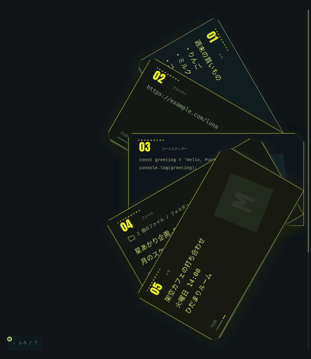

  

クリップボードマネージャーです。

  <a href="#download">ダウンロード</a> ·
  <a href="#use">使い方</a> ·
  <a href="docs/PRIVACY.md">プライバシー</a> ·
  <a href="docs/DEVELOPMENT.md">開発する</a>

  

架空のコピー内容とアプリ名を使った UI プレビューです。

## Download

| Windows | macOS | Linux |
| :--- | :--- | :--- |
| [↓ x64 インストーラー](https://github.com/kuro0315/Pupa/actions/workflows/desktop-build.yml) | [↓ Apple Silicon / Intel](https://github.com/kuro0315/Pupa/actions/workflows/desktop-build.yml) | [↓ x64 AppImage / deb](https://github.com/kuro0315/Pupa/actions/workflows/desktop-build.yml) |
| `.exe` | CPU に合う `.dmg` を選択 | `.AppImage` または `.deb` |

**v0.2.3 · Tauri + Rust 開発ビルド。未署名・未公証です。** OS によって起動をブロックされる場合があります。保護を無効化せず、[インストールガイド](docs/INSTALL.md)を確認してください。

ダウンロードには GitHub へのサインインが必要です。Actions の成功した実行から、自分の OS の Artifacts を選びます。成果物の保存期間は14日です。正式 Release はまだ公開していません。

## Copy. Call. Click.

1. **コピーする。** 起動後にコピーしたテキスト・リンク・コードが履歴に入ります。
2. **呼び出す。** Wayland では最初に設定から「システムのショートカット」を有効にします。Mac は <kbd>⌘</kbd> <kbd>⇧</kbd> <kbd>Space</kbd>。Windows / Linux は <kbd>Ctrl</kbd> <kbd>Shift</kbd> <kbd>Space</kbd>。
3. **カードをクリック。** その内容を再コピーして閉じます。貼り付け先でいつもの貼り付け操作を。

<kbd>Esc</kbd> で閉じる · 矢印キーで選ぶ · <kbd>Enter</kbd> でコピー · <kbd>Ctrl / ⌘</kbd> <kbd>F</kbd> で検索。歯車からキー変更、一時停止、履歴削除もできます。

<strong>デッキの設定を見る</strong>

 
設定画面の実画像は、同じ CI の UI Artifacts に含まれます。

履歴は **30 / 60 / 100 件**。扇の角度は **20–84°**、画面端からの距離は **0–90 px**。画面に収まる範囲に調整されます。上限を減らして既存履歴を削除するときは確認が必要です。

## Small print

- **テキスト専用。** 画像・ファイル・書式保存、自動貼り付けは非対応。
- **アプリ情報は推定。** コピー元を保証しません。取得できない環境は「アプリ不明」。GNOME / Wayland のアプリ名取得には [専用拡張機能](docs/GNOME-SOURCE.md) が必要です。アイコンは端末内のアプリから取得します。
- **秘密を扱う前は一時停止。** 秘密の自動判定は保証しません。任意の履歴保存は暗号化されません。

[プライバシーと制約](docs/PRIVACY.md) · [OS 別インストール](docs/INSTALL.md) · [開発・テスト](docs/DEVELOPMENT.md) · [正式配布までのチェックリスト](docs/DISTRIBUTION.md)

---

[ビルド・検証状況](https://github.com/kuro0315/Pupa/actions/workflows/desktop-build.yml) · [MIT](LICENSE)
